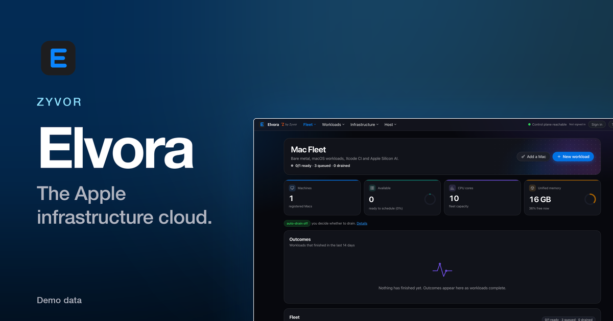
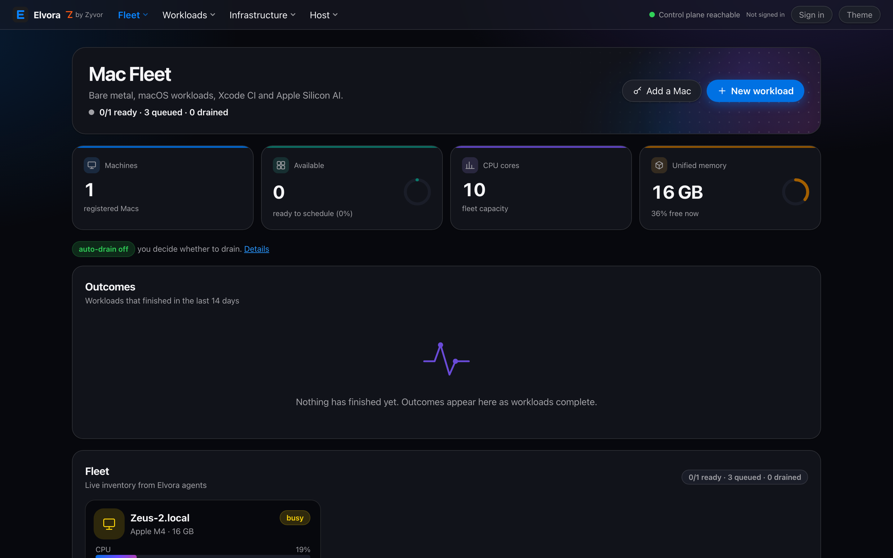
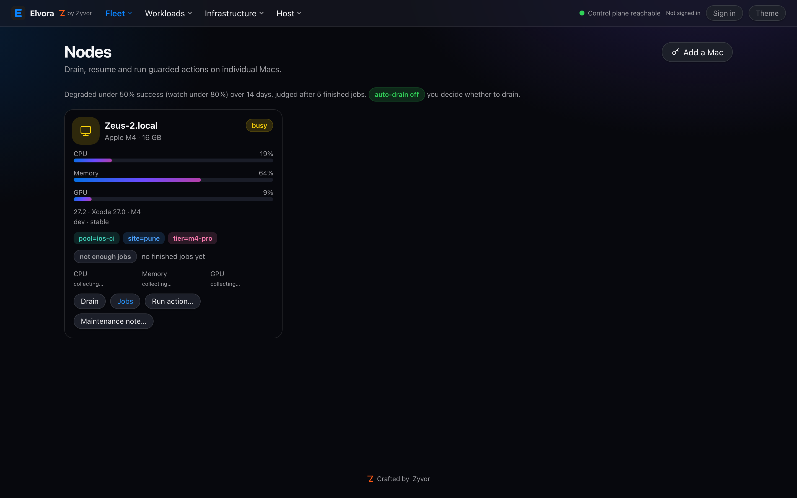
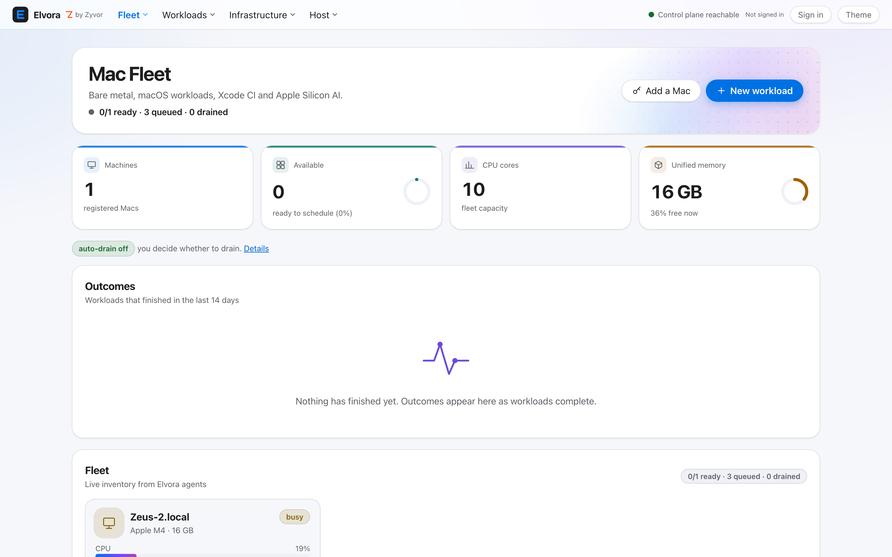
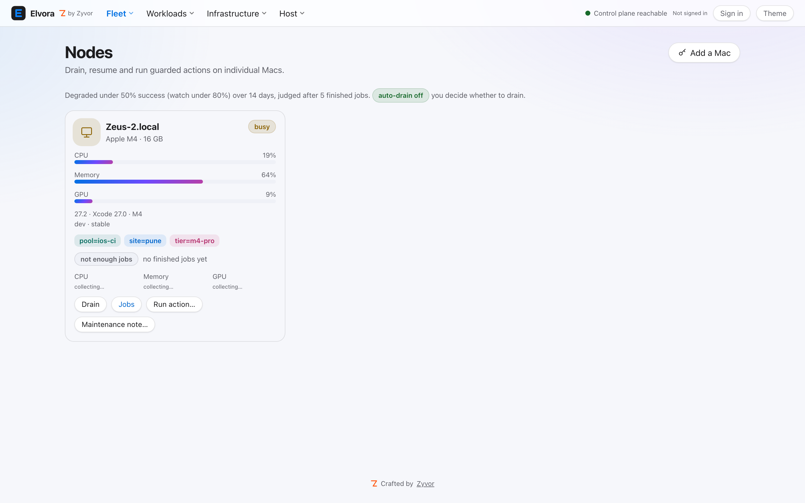
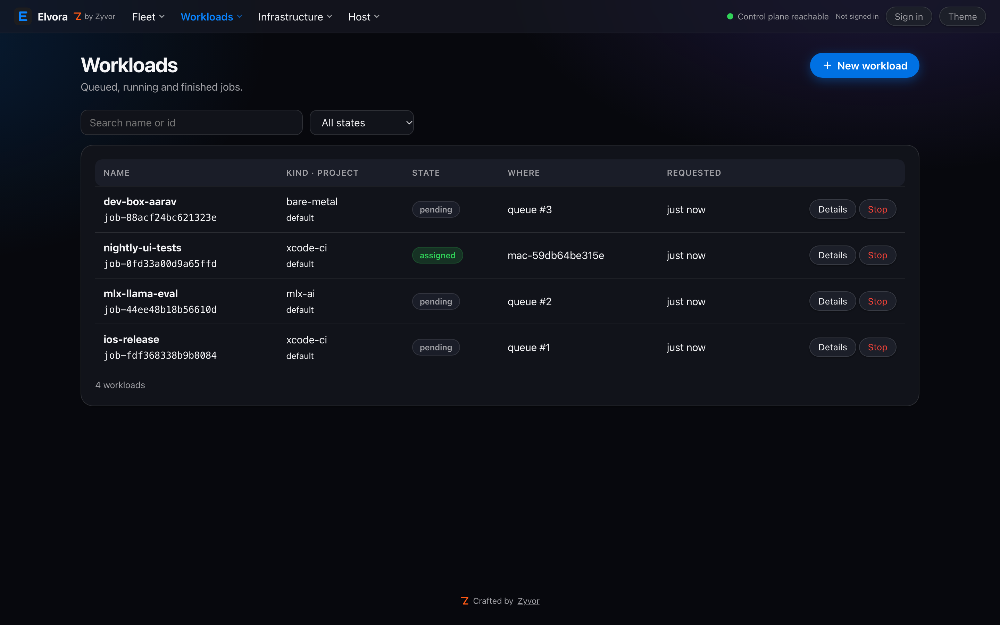
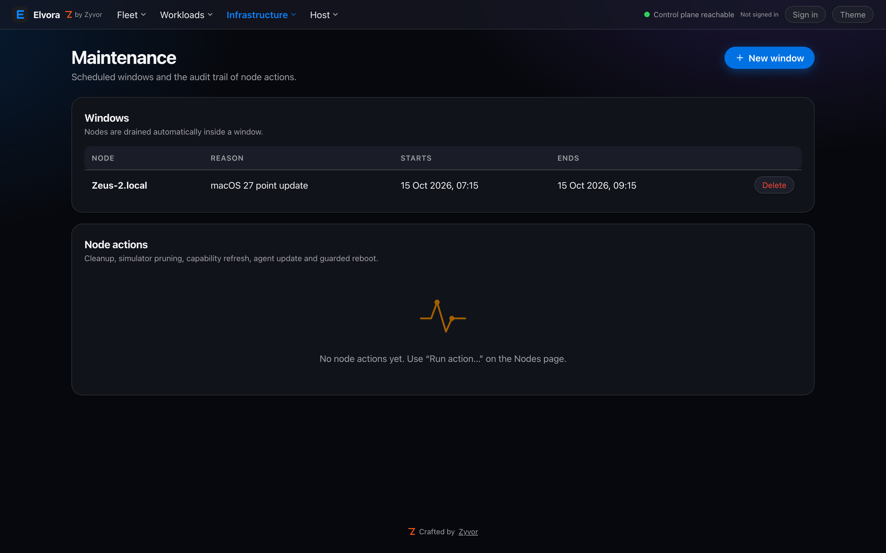

# Elvora

### The Apple infrastructure cloud.

Schedule Xcode CI, MLX, VMs and automation across your enrolled Macs.

 

**[Download the 30-day trial](https://github.com/zyvorai/elvora/releases/tag/v0.4.2)** &nbsp;·&nbsp; [Website](https://zyvorai.github.io/elvora/) &nbsp;·&nbsp; [Install guide](docs/INSTALL.md) &nbsp;·&nbsp; [Buy a licence](https://zyvor.dev/buy)

`Elvora-0.4.2.dmg` · macOS 14 or later · Apple silicon · signed and notarized

---

## Download (trial)

| | |
| --- | --- |
| **Get it** | [Elvora 0.4.2](https://github.com/zyvorai/elvora/releases/tag/v0.4.2): [`Elvora-0.4.2.dmg`](https://github.com/zyvorai/elvora/releases/download/v0.4.2/Elvora-0.4.2.dmg) and its `.sha256` checksum |
| **SHA-256** | `4f564481baf595a5de4696666bc19305d513318359e4e232cee2fdcf8867467a` |
| **Trial key** | The app runs without a key. For a free 30-day trial key, email **sales@zyvor.dev** |
| **Requirements** | The Mac app needs macOS 14 or later, Apple silicon |
| **Notarized** | Signed with our Developer ID. Notarized by Apple; macOS shows its standard first-open confirmation for apps downloaded from the internet |

Install the menu-bar app with Homebrew instead: `brew install --cask zyvorai/tap/elvora`. The agent, CLI and FluxVM runner: `brew install zyvorai/tap/elvora`. Full steps: [docs/INSTALL.md](docs/INSTALL.md). Earlier builds (agent and CLI tarball, Linux control plane) are on the [Releases page](https://github.com/zyvorai/elvora/releases).

## See it

*Screenshots are the web console of a local control plane with one registered Mac and a few queued workloads (demo data).*

| Overview | Nodes |
| --- | --- |
|  |  |
|  |  |

| Workloads | Maintenance |
| --- | --- |
|  |  |

## What it does

Elvora is a control plane, an agent, a CLI and a menu-bar app that turn fleets of Mac mini and Mac Studio systems into schedulable infrastructure for Xcode CI, native Apple Silicon AI, dedicated developer machines, automation and macOS VM orchestration (FluxVM).

- **Fleet:** a native agent reports Apple chip, memory, OS, Xcode, IP and capabilities; the control plane keeps the inventory live. Labels such as `site=pune`, `pool=ios-ci`, `tier=m4-pro`.
- **Scheduler that explains itself:** filters on available memory, chip, GPU family and labels; an explainable score from free memory and utilization; priority queueing with automatic rescheduling. One active workload per Mac.
- **Four kinds of work:** `bare-metal`, `xcode-ci`, `mlx-ai` and `macos-vm` (a pluggable FluxVM or Virtualization.framework adapter), with runtime deadlines, bounded output capture, native exit codes and real cancellation.
- **Maintenance:** reservations, maintenance windows, drain and resume, and an auditable queue of node actions (cleanup, simulator pruning, capability refresh, agent update, guarded reboot).
- **Security and control:** HMAC-SHA256 signed assignments with expiry, node binding and a nonce; separate agent and operator credentials with optional viewer and admin RBAC tokens; audit trail.
- **Operations:** `/healthz`, `/readyz`, Prometheus-compatible `/metrics`, a Docker image, a launchd agent example.
- **Menu-bar app:** shows control-plane status from `ELVORA_SERVER` and `ELVORA_API_TOKEN`.

## Requirements

- The Mac app requires **macOS 14 or later**, on Apple silicon.
- FluxVM on the Mac should be 0.4.18 or later for `macos-vm` workloads (see the [install guide](docs/INSTALL.md)).
- **Status:** developer preview. Production-shaped control plane and agent, **not** yet a hardened multi-tenant security boundary. Read [SECURITY.md](SECURITY.md) before deploying outside a trusted environment.

## Trial and licence

- The app runs without a key. For a free 30-day trial key, email sales@zyvor.dev.
- **Licence:** ₹19,942 per enrolled Mac per year including GST. Buy at https://zyvor.dev/buy or on the [payment page](https://rzp.io/rzp/sW0fMhui).
- Plain-language terms: [LICENSING.md](LICENSING.md). Multi-Mac invoices: [sales@zyvor.dev](mailto:sales@zyvor.dev).

## Documentation

- [Website](https://zyvorai.github.io/elvora/)
- [Install guide](docs/INSTALL.md)
- [Client overview (PDF)](docs/Elvora-Client-Overview.pdf)
- [Licensing in plain words](LICENSING.md) · [Security](SECURITY.md)

The Elvora source code is private. This repository holds the website, documentation and downloadable builds.

The website and documentation are Copyright 2026 Zyvor AI Labs ([LICENSE](LICENSE)).
