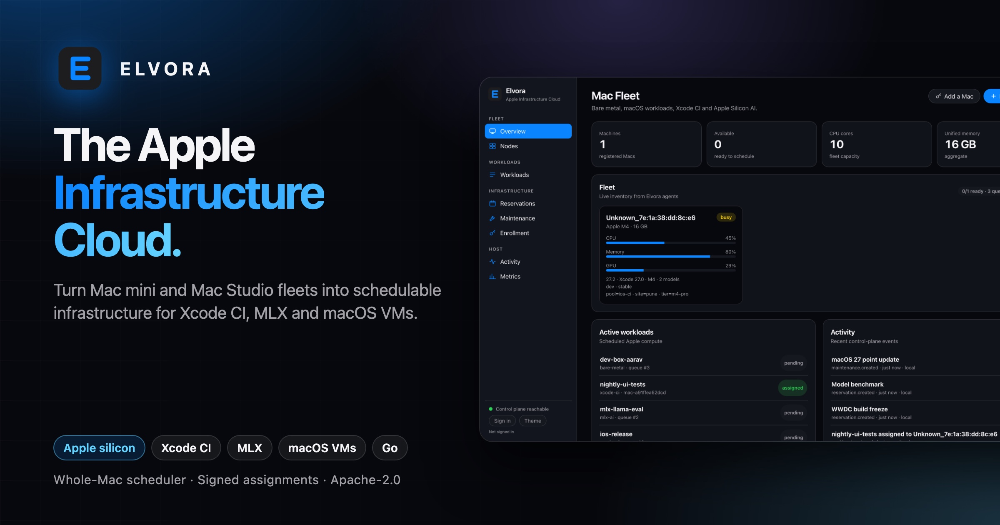
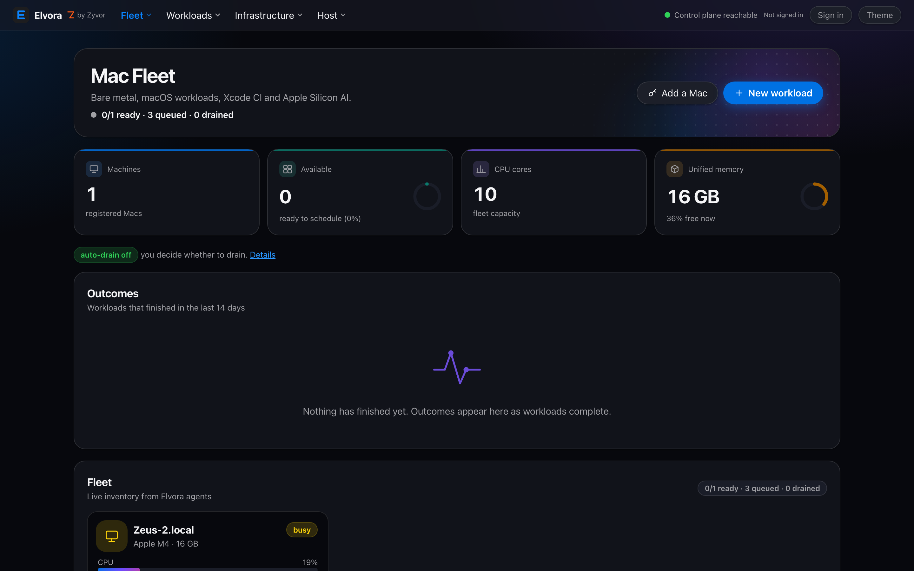
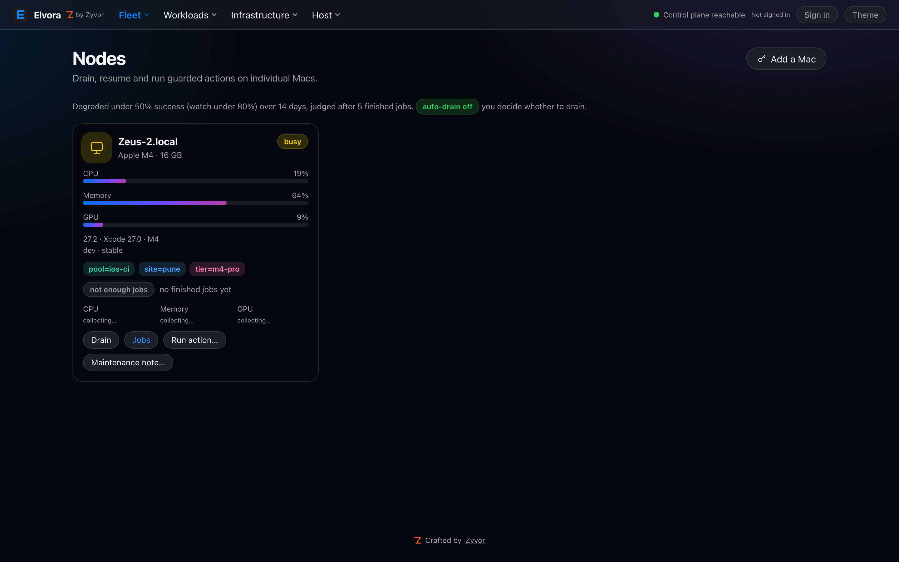
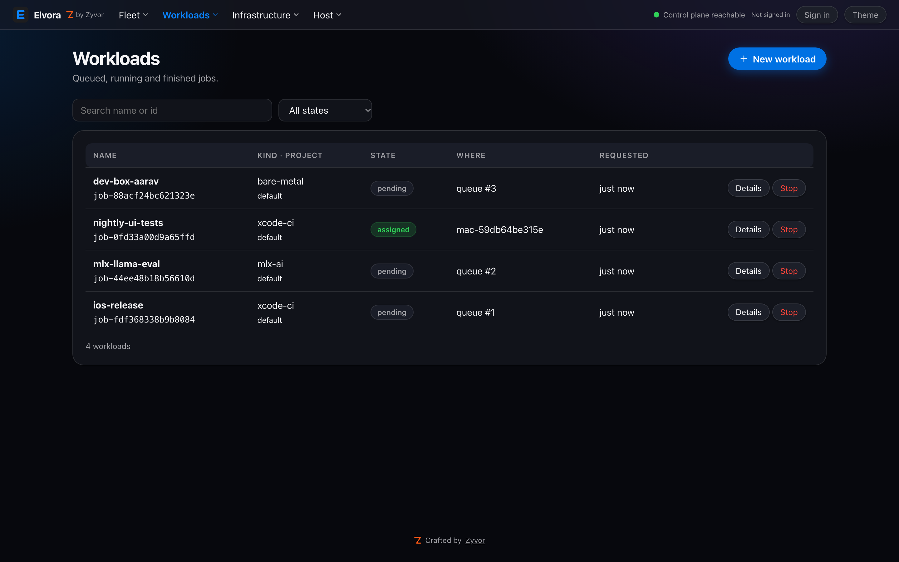
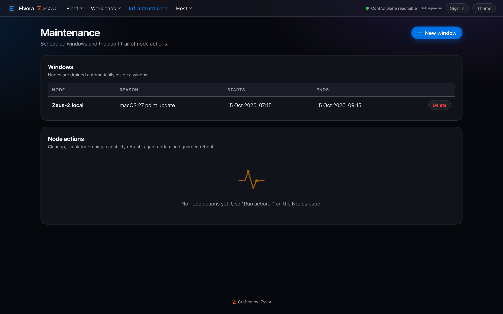

<div align="center">


# Elvora

**The Apple Infrastructure Cloud.**

[](https://github.com/zyvorai/elvora/releases/tag/v0.4.1)
[](https://github.com/zyvorai/elvora/releases/download/v0.4.1/Elvora-0.4.1.dmg)
[](https://github.com/zyvorai/elvora/releases/download/v0.4.1/elvora-darwin-arm64.tar.gz)
[](https://zyvorai.github.io/elvora/)
[](docs/INSTALL.md)
[](LICENSING.md)



✨ **[New in 0.4](#new-in-04)** · 🖼️ **[Gallery](#gallery)** · 🌐 **[Website](https://zyvorai.github.io/elvora/)** · 📦 **[Install guide](docs/INSTALL.md)**

| ⬇️ Download v0.4.1 | Size | SHA-256 |
| --- | --- | --- |
| [**Elvora-0.4.1.dmg**](https://github.com/zyvorai/elvora/releases/download/v0.4.1/Elvora-0.4.1.dmg): menu-bar app, drag to Applications | 116 KB | [`e435d60d…df5a3e1`](https://github.com/zyvorai/elvora/releases/download/v0.4.1/Elvora-0.4.1.dmg.sha256) |
| [**elvora-darwin-arm64.tar.gz**](https://github.com/zyvorai/elvora/releases/download/v0.4.1/elvora-darwin-arm64.tar.gz): agent, CLI, FluxVM runner | 8.1 MB | [`c2026dcb…c8d7b1`](https://github.com/zyvorai/elvora/releases/download/v0.4.1/elvora-darwin-arm64.tar.gz.sha256) |
| [**elvora-linux-amd64.tar.gz**](https://github.com/zyvorai/elvora/releases/download/v0.4.1/elvora-linux-amd64.tar.gz): server + CLI for Linux amd64 | 12 MB | [`109e1f90…de9956`](https://github.com/zyvorai/elvora/releases/download/v0.4.1/SHA256SUMS) |
| [**elvora-linux-arm64.tar.gz**](https://github.com/zyvorai/elvora/releases/download/v0.4.1/elvora-linux-arm64.tar.gz): server + CLI for Linux arm64 | 11 MB | [`5452b720…050f87`](https://github.com/zyvorai/elvora/releases/download/v0.4.1/SHA256SUMS) |

<sub>Developer ID signed and notarized. All releases: <a href="https://github.com/zyvorai/elvora/releases">Releases</a>.</sub>

</div>

Elvora turns fleets of **Mac mini** and **Mac Studio** systems into schedulable Apple infrastructure for Xcode CI, native Apple Silicon AI, dedicated developer machines, automation and macOS VM orchestration (FluxVM).

This repository holds the **website, documentation and downloadable builds** (see Releases). It does **not** contain the control-plane source code.

## Get started

1. Install with Homebrew (Apple silicon):

   ```bash
   brew install zyvorai/tap/elvora          # agent, CLI, FluxVM runner
   brew install --cask zyvorai/tap/elvora   # menu-bar app
   ```

   Or download [`elvora-darwin-arm64.tar.gz`](https://github.com/zyvorai/elvora/releases/download/v0.4.1/elvora-darwin-arm64.tar.gz) / the [`.dmg`](https://github.com/zyvorai/elvora/releases/download/v0.4.1/Elvora-0.4.1.dmg). See [INSTALL.md](docs/INSTALL.md).
2. Buy a licence on [Cashfree](https://payments.cashfree.com/forms/zyvor-elvora) ($49 / enrolled Mac / year; India + international cards).
3. Start a control plane, enroll Macs, submit workloads.

## New in 0.4

- **FluxVM 0.4.18+ runner:** version floor, `MODE=session`, optional netobs history, network + snapshot on workload detail.
- **Capacity page** and queue / usage / scale-hints API for operators.
- **Notarized** macOS DMG and darwin-arm64 CLI tarball.

## Gallery

| Overview | Nodes |
| --- | --- |
|  |  |
| **Workloads** | **Maintenance** |
|  |  |

## Status

v0.4 developer preview: production-shaped control plane and agent, **not** yet a hardened multi-tenant security boundary. Read [SECURITY.md](SECURITY.md) before deploying outside a trusted environment.

## Pricing and licence

Elvora is **not free to use**. **$49 per enrolled Mac per year** (about ₹4,150 excl. GST in India). Buy on [Cashfree](https://payments.cashfree.com/forms/zyvor-elvora) (India + international cards) or [sales@zyvor.dev](mailto:sales@zyvor.dev). Plain-language terms: [LICENSING.md](LICENSING.md).

The website and documentation are Copyright 2026 Zyvor AI Labs ([LICENSE](LICENSE)).
